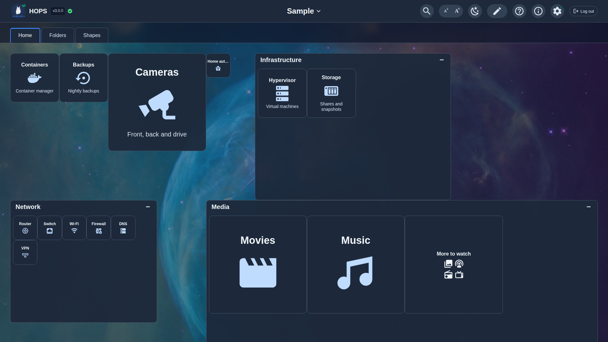
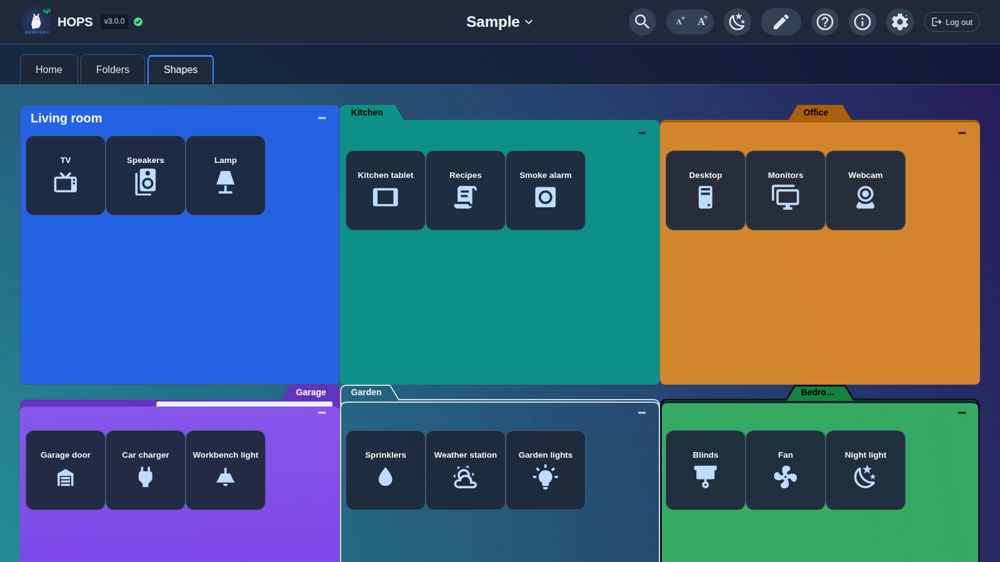
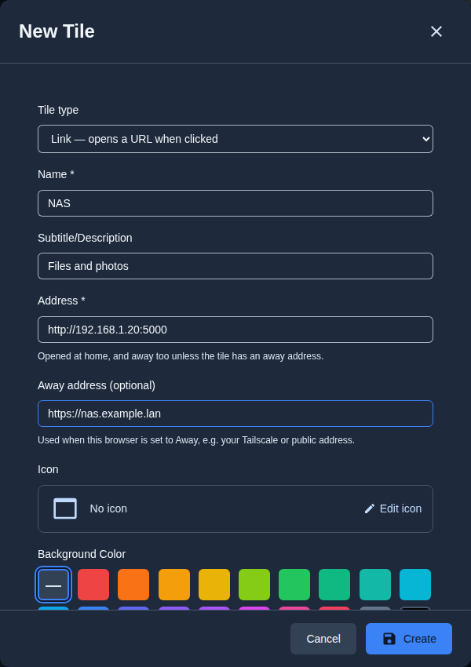
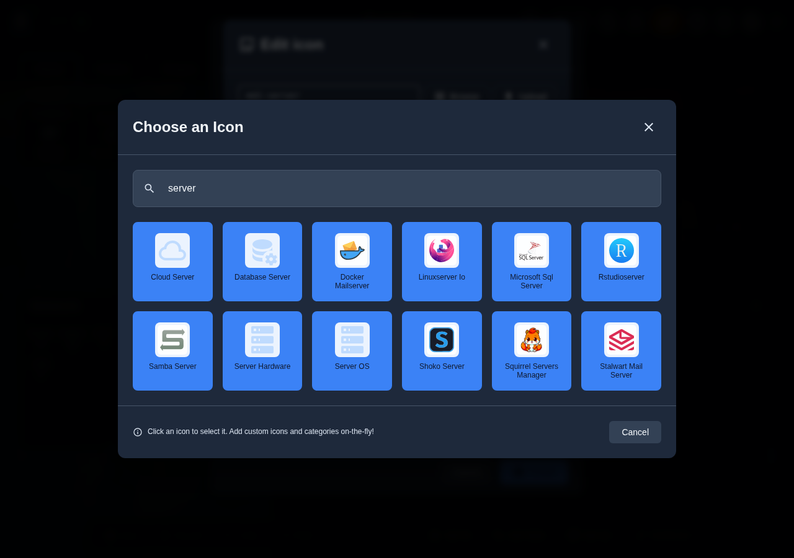
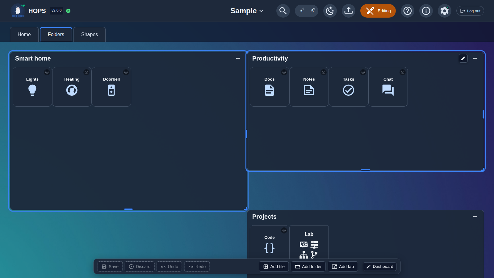
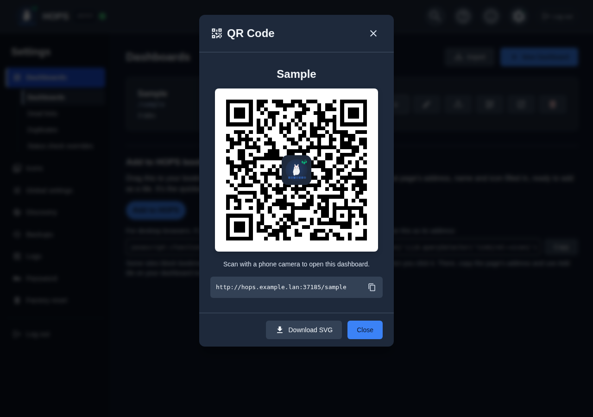
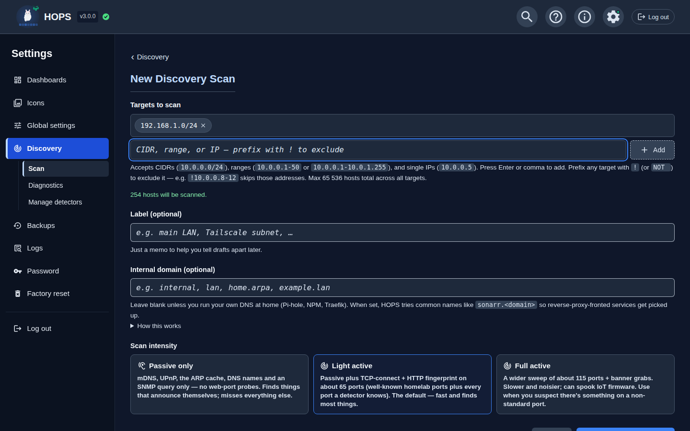
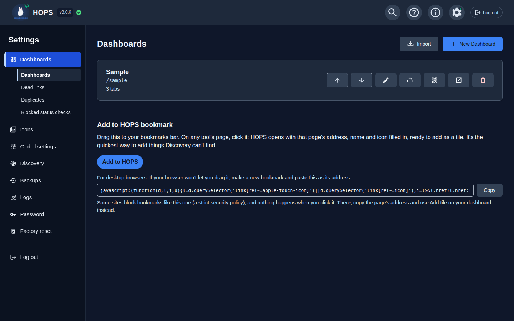
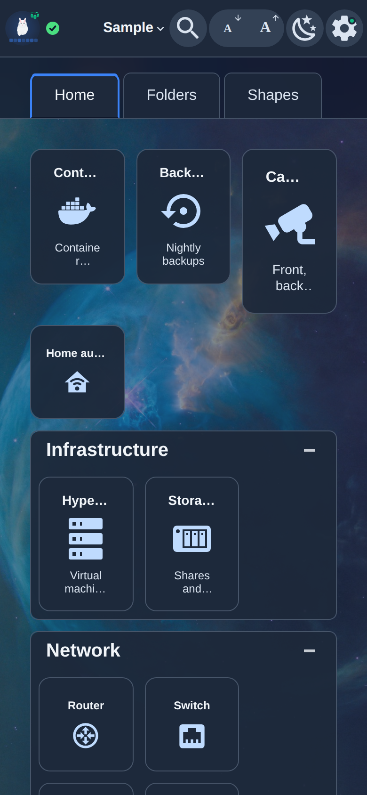

# HOPS User Guide (v3.0.0)

This is the reference for HOPS 3: what every part of HOPS does, where to
find it, and what the defaults are. New to HOPS? Start with
[Zero to Dashboard Hero](QUICKSTART.md), a guided tour from install to your
first dashboard. Come back here when you want to look something up.

For installing, running as a service, reverse proxies and HTTPS, see the
[Installation & Deployment Guide](DEPLOY.md).



## Contents

1. [Addresses and signing in](#addresses-and-signing-in)
2. [Dashboards](#dashboards)
3. [Tabs](#tabs)
4. [Folders](#folders)
5. [Tiles](#tiles)
6. [The editor](#the-editor)
7. [Backgrounds](#backgrounds)
8. [Header](#header)
9. [Home and away](#home-and-away)
10. [Status checks](#status-checks)
11. [Search](#search)
12. [QR codes](#qr-codes)
13. [Add to HOPS bookmark](#add-to-hops-bookmark)
14. [Dead links and duplicates](#dead-links-and-duplicates)
15. [Network Discovery](#network-discovery)
16. [Import and export](#import-and-export)
17. [Backups](#backups)
18. [Settings](#settings)
19. [Password and sessions](#password-and-sessions)
20. [Per-browser preferences](#per-browser-preferences)
21. [Phones, tablets and touch](#phones-tablets-and-touch)
22. [Upgrading from HOPS 2](#upgrading-from-hops-2)
23. [Troubleshooting](#troubleshooting)

---

## Addresses and signing in

| Address | What it shows | Sign-in needed? |
|---------|---------------|-----------------|
| `http://<server>:8080/` | Your first dashboard (the top one in **Settings › Dashboards**) | No |
| `http://<server>:8080/<path>` | The dashboard with that path, e.g. `/home` | No |
| `http://<server>:8080/settings` | Settings (opens on **Dashboards**) | Yes |
| `http://<server>:8080/add` | The **Add to HOPS** page (see [Add to HOPS bookmark](#add-to-hops-bookmark)) | Yes, to add |

Anyone who can reach HOPS can view its dashboards. You only sign in to
change things. That makes it easy to pin a dashboard on a wall tablet or
share a link with the household.

**Signing in.** Click the **pencil** in the top bar (*Sign in to edit this
dashboard*) or the **gear** (**Settings**). The first sign-in is `admin` /
`admin`, and HOPS makes you set a new password straight away; see
[Step 2: Sign in](QUICKSTART.md#step-2-sign-in). Once signed in, a **Log
out** button sits at the right of the top bar.

Old addresses from HOPS 2 still work where it makes sense: anything under
`/admin/discovery` goes to the matching page under
`/settings/discovery`.

The port is 8080 unless you changed it under **Settings › Global settings ›
Server › Port** (see [Change the port](QUICKSTART.md#change-the-port)).

---

## Dashboards

A dashboard is one page with its own path. Each dashboard has one or more
[tabs](#tabs); each tab holds [tiles](#tiles) and [folders](#folders).

```
Dashboard        one page with its own path, e.g. /home
└── Tab          the row of tabs across the top
    ├── Tile     a link, an SSH shortcut or a note
    └── Folder   a box with a title, holding tiles, other folders, or both
        └── Tile / Folder ...
```

### Managing dashboards

Everything about the list of dashboards is on **Settings › Dashboards**:

- **New Dashboard**: type a **Name**; the **URL Path** fills itself in from
  the name (`Home` becomes `/home`) and you can change it. Click **Save**.
  A new dashboard starts with one empty tab called *Home*. With no
  dashboards at all, the page shows **Create Your First Dashboard**
  instead.
- **Import**: see [Import and export](#import-and-export).
- Each dashboard in the list has these buttons:
  - **Move up** / **Move down**: the order of the list. The top dashboard
    is the one `/` opens.
  - **Rename**: change the **Name** and the **URL Path**.
  - **Export**: download that dashboard as a HOPS JSON file.
  - **Show QR code (scan with phone)**: see [QR codes](#qr-codes).
  - **Open in new tab**.
  - **Delete**: asks first. There is no undo, but HOPS takes a backup
    before the change, so restoring that backup brings the dashboard back
    (see [Backups](#backups)).
- Click a dashboard's name to open it.

Under the list is the [Add to HOPS bookmark](#add-to-hops-bookmark). The
**Dead links**, **Duplicates** and **Blocked status checks** pages are
listed under **Dashboards** in the Settings sidebar (on a phone, as chips
at the top of the page).

**Path rules.** A path can't start or end with a space, can't contain a
backslash or control characters, and can't begin with a name HOPS uses for
its own pages: `/add`, `/admin`, `/settings`, `/api`, `/icons`,
`/backgrounds`, `/presets` or `/_app`.

### The Sample

A fresh install opens on the **Sample** dashboard. It shows tiles in all
three sizes, nested folders, every folder look and a background picture.
Its addresses are made up (`*.example.lan`), so its tiles don't go anywhere.
Delete it from **Settings › Dashboards** when you're done with it. A
[factory reset](#factory-reset) brings it back.

### Switching dashboards

- Signed in, the dashboard's name in the middle of the top bar is a menu
  of all your dashboards.
- For everyone, the left of the top bar links to your dashboards (unless
  the [header](#header) shows custom text there).
- Or go straight to the address, such as `http://<server>:8080/media`.

### A dashboard's own settings

In [edit mode](#the-editor), the **Dashboard** button in the toolbar opens
**Edit Dashboard**, in three parts:

- **Header**: see [Header](#header).
- **Background**: see [Backgrounds](#backgrounds).
- **Settings**: per-dashboard versions of a few global settings. Each row
  shows the global value (*Inherited: …*) until you tick **Override for
  this dashboard**; **Reset to inherit** puts it back. (**Status checks for
  tiles in this dashboard** is different: it is an **Enabled** / **Disabled**
  gate, described under [Status checks](#status-checks).)

  | Row | Global setting it overrides |
  |-----|-----------------------------|
  | **Check interval (minutes)** | Global settings › Status checks › **Check every (minutes)** |
  | **Check timeout (seconds)** | Global settings › Status checks › **Give up after (seconds)** |
  | **Edit mode idle timeout (minutes)** | Global settings › Editing › **Edit mode times out after (minutes)** |
  | **Animated folder backgrounds** | Global settings › Look & motion › **Animated folder backgrounds** |

---

## Tabs

Tabs run across the top of a dashboard. Click one to switch to it.

In edit mode:

- **Add tab** (toolbar) opens **New Tab**.
- To change a tab, click the pencil next to its name, or right-click it.
  The menu has **Edit**, **Duplicate** and **Delete**.
- Drag a tab's name to reorder the tabs.

The tab dialog has:

| Field | Notes |
|-------|-------|
| **Tab Name** | Required. |
| **Icon (optional)** | **Edit icon** opens the icon editor (see [Icons](#icons)). |
| **Background Color** and **Opacity** | The tab's own colour. *None* uses the theme's. |
| **Status checks for tiles in this tab** | **Enabled** or **Disabled**. Disabled stops every check on the tab. See [Status checks](#status-checks). |
| **Configure Tab Background** | **Same as the dashboard** or **Its own background**. See [Backgrounds](#backgrounds). |

The dialog's footer has **Delete** and **Duplicate** for an existing tab.

A dashboard holds at most 200 tabs.

Tabs and folders are both ways to organise. Some people give each area its
own tab; others keep one tab and use folders; many mix the two.

---

## Folders

A folder is a box on a tab with a title bar, holding tiles, other folders
or both.



### Making folders

- **Add folder** in the toolbar, or **Add folder here** when you right-click
  inside a folder or on a tab's empty space.
- Drag one tile onto the middle of another and hold: the cue says *Hold to
  make a folder*, then *Make a folder*. Let go, and the new folder's
  dialog opens.

Step by step: [Add folders](QUICKSTART.md#add-folders).

### The folder dialog

**Edit Folder** (or **New Folder**) has these parts:

| Part | Field | Choices and defaults |
|------|-------|----------------------|
| | **Folder name** | Required. |
| | **Icon (optional)** | **Edit icon**; see [Icons](#icons). |
| **Look** | (the shape) | *Rounded box*, *Simple tab*, *Folder (flat)*, *Folder with paper*, *Folder (outlined)*, *Folder (cartoon)*, *Folder (open flap)*. Each has a live preview. A folder you make with **Add folder** starts as *Folder (flat)*. |
| | **Tab position** | *Left*, *Centre*, *Right*. Every look except Rounded box has a tab. |
| **Colour** | **Folder colour** | A swatch, **Custom** (any colour), or *None* for the theme's colour. |
| | **Opacity** | How see-through the folder is. |
| | **Text colour** | *Auto* (default), *Light*, *Dark*. HOPS warns when the text would be hard to read on the colour. |
| **Display** | **Starts** | *Expanded* or *Collapsed*: how the folder looks to anyone who hasn't minimised or opened it themselves. |
| | **Contents size** | *Small*, *Medium*, *Large*. Every tile and folder inside is shown at this size. |
| | **Size when minimised** | *Small*, *Medium*, *Large*: the size of its folder tile when minimised. |
| | **Show title bar** | Untick for a box without a name bar. |
| | **Status checks for tiles in this folder** | **Enabled** or **Disabled**. Disabled stops every check inside. See [Status checks](#status-checks). |
| **Background** | **Background…** | A picture or slideshow inside the folder. See [Folder backgrounds](#folder-backgrounds). |
| **Move or copy** | **Move or copy to…** | See [Move/Copy to…](#movecopy-to). |

The footer has **Delete** and **Duplicate** for an existing folder.

### Open and minimised

A folder on a tab is either open (a box showing its contents) or minimised
(a single folder tile).

- The **minimise** button on the title bar shrinks it to a folder tile.
  Click the folder tile to open it again.
- This is the **viewer's** choice. Each browser remembers what it
  minimised or opened, so minimising on your phone doesn't change anyone
  else's view. To change how a folder starts for everyone, set **Starts**
  in its dialog.
- In edit mode you see the saved layout. There, **Minimise** and **Open**
  in a folder's right-click menu change its saved **Starts** setting (and
  can be undone).

### Folders inside folders

A folder inside a folder always shows as its folder tile. Click it and it
opens in place, inside its parent. The title bar shows the path (*Media ›
Streaming*); click a parent's name to go back up. In edit mode, a
sub-folder's right-click menu has **Open** (or **Close** once you are in
it).

Folders nest up to 12 levels deep. Every level is one more click to reach
a tile, so we suggest no more than three; [Search](#search) finds things at
any depth.

### Size and pages

An open folder takes a box on the tab's grid. Make it bigger or smaller by
dragging its edges in edit mode, or select it and press **Shift**+arrow
keys (see [Resizing](#resizing)). A folder is never smaller than its title
bar, one item and its page bar.

When a folder holds more than fits, it shows one page at a time with a page
bar at the bottom: **«** **‹** the page numbers **›** **»**. A bigger
folder shows more on each page. Each browser remembers which page each
folder was on.

---

## Tiles

A tile is one item on a tab or in a folder.



### Tile types

**Tile type** is at the top of the tile dialog:

| Type | What a click does | Needs |
|------|-------------------|-------|
| **Link — opens a URL when clicked** | Opens the **Address** (see [Open modes](#open-modes)). | **Name**, **Address** |
| **SSH — opens your computer's SSH app** | Opens an `ssh://` link, which your computer hands to its SSH app. | **Name**, **Host** |
| **Note — text only, no link** | Nothing. A heading and some **Body text**. | **Name** |

On Windows you may need to set up an SSH app first (for example PuTTY or
Windows Terminal) before SSH tiles open anything.

### The tile dialog

| Field | Types | Notes |
|-------|-------|-------|
| **Name** | all | Required. For a Note, the heading. |
| **Subtitle/Description** | Link, SSH | Small text under the name. For a Note this field is **Body text**. |
| **Address** | Link | The home address, e.g. `http://192.168.1.1`. HOPS says under the field if it can't open what you typed. |
| **Away address (optional)** | Link | See [Home and away](#home-and-away). |
| **Host**, **Port**, **User** | SSH | **Port** is 22 if left blank; **User** is optional. |
| **Away host (optional)**, **Away port** | SSH | See [Home and away](#home-and-away). |
| **Icon** | Link, SSH | **Edit icon**; see [Icons](#icons). |
| **Background Color** | all | A swatch, **Custom**, or *None* for the theme's colour. |
| **Background opacity** | all | Fades the tile's background only. |
| **Text opacity** | all | Fades the text. |
| **Icon opacity** | Link, SSH | Fades the icon. The status badge is never faded. |
| **Size** | all | *Small*, *Medium* (default), *Large*. |
| **Open Mode** | Link | See [Open modes](#open-modes). SSH tiles always open in place. |
| **Status check** | Link, SSH | **On** or **Off** (Off by default). See [Status checks](#status-checks). |
| **Move or copy to…** | all | See [Move/Copy to…](#movecopy-to). |

Greyed italic text in an empty field is only an example, not a value.

The footer has **Delete**, **Cancel**, and **Create** (new tile) or
**Save**.

### Sizes and the grid

Each tab is a grid 24 columns wide. On a tab, a tile takes the space of its
**Size**: *Small* is 1 × 1 cells, *Medium* 2 × 2 and *Large* 4 × 4. To make
a tile bigger or smaller, change its **Size**; tiles have no resize
handles. Inside a folder, every item is shown at the folder's **Contents
size** instead.

Items never overlap. Dropping or resizing something where others already
are pushes them aside.

### Open modes

**Open Mode** decides what clicking a Link tile does:

- **New Tab** (default): opens the address in a new browser tab.
- **Same Tab**: replaces HOPS with the service.
- **iFrame Modal**: shows the service in a window on top of HOPS. Some
  sites refuse to be shown inside another page; use New Tab for those.
- **Popup Modal**: asks first, with **Open in New Tab** and **Open in Same
  Tab**.

### Icons

**Edit icon** opens the icon editor:

- Type a name for suggestions (↑/↓ to move, Tab or Enter to accept), for
  example `mdi:server`. Any icon name from
  [iconify.design](https://iconify.design) works.
- **Browse** opens **Choose an Icon**, the icon library, with categories,
  your uploads and your recently used icons.
- **Upload** adds your own image (PNG, JPG, GIF, WebP or SVG; up to 2 MB
  by default, set under **Settings › Global settings › Uploads › Largest
  icon upload**).
- **Icon background** puts a colour behind the icon.
- Click **Done**.



**Offline icons.** HOPS ships thousands of icons that work with no internet
connection: the Dashboard Icons set (logos for homelab apps, some with
light and dark versions) and an offline bundle of Material Design and
Simple Icons. Uploaded icons are stored on your HOPS server. Any other
Iconify name is fetched from the internet the first time it is used.
**Settings › Icons › Offline and limits** shows the counts.

**Settings › Icons** also manages your uploads: **Search icons**, filter by
**Show category**, **Upload icons** (one or several at a time) into a
category, rename or recategorise an icon, delete one that isn't in use, and
add your own categories under **Your categories**.

---

## The editor



Click the **pencil** in the top bar (*Enter Edit Mode*) to start editing the
dashboard you're on. It turns into an **Editing** badge; click it again to
leave edit mode. Step-by-step introduction: [Edit
mode](QUICKSTART.md#edit-mode).

### The toolbar

Pinned to the bottom of the screen while you edit:

| Button | What it does |
|--------|--------------|
| **Save** (Ctrl+S) | Stores your draft. A *Changes saved* message confirms it. |
| **Discard** | Throws away everything since the last save. Asks first (*Discard changes?*); **Keep editing** backs out. |
| **Undo** (Ctrl+Z) / **Redo** (Ctrl+Shift+Z or Ctrl+Y) | One step at a time: a drag, a resize, a delete, or everything changed in one dialog. |
| *Unsaved changes* | Shows while your draft differs from what is saved. |
| **Add tile**, **Add folder**, **Add tab** | Adds to the tab (or the open folder) you're looking at. |
| **Dashboard** | The dashboard's **Header**, **Background** and **Settings**. |

On a Mac, use Cmd where this guide says Ctrl.

While editing, an **Export Dashboard** button also appears in the top bar
(see [Export](#export)).

### Selection

- Click a tile or folder to select it.
- Ctrl-click (Cmd-click on a Mac) adds an item to the selection, or takes
  it out.
- **Escape** clears the selection.

Copy, cut, delete, **Move/Copy to…** and **Shift**+arrow resizing work on
the selection.

### Drag and drop

- Drag a tile or folder to move it around the grid. Others move aside to
  make room.
- Drop it on a folder to put it inside (the cue says *Into "…"*). Drop it
  on an open folder's title bar to put it at the end of that folder.
- Hold a dragged tile over the middle of another tile to make a new folder
  of the two (see [Making folders](#making-folders)).
- Hold a dragged item over another tab's name to switch to that tab, and
  drop it there.
- Drag a tab's name to reorder the tabs.
- **Escape** while dragging cancels the drag and leaves everything as it
  was.

Every drop can be undone.

### Context menus

Right-click in edit mode (on a touch screen, press and hold; see [Touch
editing](#touch-editing)):

| On | Menu |
|----|------|
| A tile | **Edit**, **Duplicate**, **Cut**, **Copy**, **Paste here** (beside it), **Move/Copy to…**, **Delete** |
| A folder | **Edit**, **Open** (if minimised or nested) or **Close**, **Duplicate**, **Cut**, **Copy**, **Paste here** (into it), **Move/Copy to…**, **Minimise** (if open on a tab), **Delete** |
| Several selected items | **Cut**, **Copy**, **Paste here**, **Move/Copy to…**, **Delete *n* items** |
| Empty space on a tab, or inside an open folder | **Add tile here**, **Add folder here**, **Paste here** |
| A tab's name | **Edit**, **Duplicate**, **Delete** |

Every item also has a small **pencil** that opens its dialog, or you can
double-click it.

### Cut, copy and paste

- **Ctrl+C** / **Copy** copies the selected items. **Ctrl+X** / **Cut**
  cuts them. A copy is a snapshot: changing the originals later doesn't
  change what you paste.
- **Ctrl+V** pastes into the open folder (or the tab). **Paste here** in a
  menu pastes exactly where you right-clicked.
- Pasting a copy makes new items (with everything inside a folder). Pasting
  a cut moves the originals.
- The clipboard lasts while the page is open, so you can paste on another
  dashboard. Pasting on a different dashboard is saved straight away, so
  HOPS asks you to save or discard your changes first.
- If text is selected on the page, Ctrl+C copies the text instead.

### Move/Copy to…

**Move/Copy to…** (right-click menu, or **Move or copy to…** in a tile or
folder dialog) opens a tree of every dashboard, tab and folder. Pick the
destination and click **Copy** or **Move**.

- On the same dashboard, it's an ordinary edit: part of your draft, and one
  undo step.
- To another dashboard, it is saved straight away, so it is only allowed
  while you have no unsaved changes (*Save or discard your changes first*).
- A place the items can't go is marked, for example *Already here (copy
  only)*.

### Resizing

Only open folders on a tab have resize handles. Drag the right edge, the
bottom edge or the corner, or select the folder and press **Shift**+arrow
keys to grow or shrink it one cell at a time. Tiles take the space of
their **Size**; a minimised folder is opened first. Resizing needs a wider
screen: it isn't available in the one-column phone layout.

### Deleting

**Delete** in a menu or dialog, or press **Delete** (or Backspace) with
items selected. HOPS asks first. A deleted folder takes everything inside
it with it. Undo brings it back until you leave edit mode.

### Limits

Each dashboard holds at most:

- **200 tabs**;
- **5,000 items** (tiles and folders, at any depth);
- **12 levels** of folders inside folders.

HOPS refuses a change that would go past a limit when you make it, and says
why, rather than when you click Save.

### Saving and drafts

While you edit, you are changing a **draft** of one dashboard. Nobody else
sees it, and nothing is stored until you click **Save**.

- In a dialog, **Create** or **Save** puts that dialog's changes into your
  draft; **Cancel** throws away just that dialog's changes.
- Leaving edit mode with unsaved changes asks **Save**, **Discard** or
  **Keep editing**. Closing or reloading the page makes the browser ask
  before you lose them.
- **Idle timeout.** Edit mode switches itself off after 15 minutes without
  activity (**Settings › Global settings › Editing › Edit mode times out
  after (minutes)**; 0 turns it off; a dashboard can override it). With
  unsaved changes it never throws them away: it asks **Save**, **Discard**
  or **Keep editing**, and waits.
- **Changed elsewhere.** If the dashboard was saved from another browser or
  tab while you were editing, your save is refused and a banner says *This
  dashboard was changed somewhere else, so your changes were not saved*.
  Choose **Reload (lose my draft)** or **Keep editing**.
- **Signed out while editing.** Unsaved changes are kept while the page
  stays open. A banner says so; sign in, open that dashboard and click Edit
  to get them back, or click **Discard them**.
- HOPS takes a backup before every save (see [Backups](#backups)).

### Keyboard shortcuts

**Help** in the top bar (once signed in) lists these too.

| Keys | Where | Does |
|------|-------|------|
| `/` | anywhere | Opens [Search](#search). |
| Arrow keys | viewing | Move between tiles; the focused tile has a blue halo. |
| Enter | viewing | Opens the focused tile. |
| Ctrl+S | editing | Save. |
| Ctrl+Z | editing | Undo. |
| Ctrl+Shift+Z or Ctrl+Y | editing | Redo. |
| Ctrl+C / Ctrl+X / Ctrl+V | editing | Copy / cut / paste. |
| Delete or Backspace | editing | Delete the selection (asks first). |
| Shift+arrow keys | editing | Resize the selected open folder by one cell. |
| Alt+← / Alt+→ | editing | Move the focused tab left or right. |
| Escape | editing | Clear the selection; cancel a drag; close a dialog. |
| Ctrl+Enter | in a dialog | Save and close the dialog. |

### Animations

In edit mode, a tile dropped into a folder flies into it, and two tiles
merged into a folder are drawn together. **Settings › Global settings ›
Look & motion › Animations** is *On* (the default: plays them unless your
device asks for reduced motion), *Always* or *Off*. They never delay your
change.

---

## Backgrounds

A background can go behind the whole dashboard, behind one tab, or inside
one folder. Each is part of your draft like any other change: save the
dialog, then click **Save** in the toolbar. Step by step:
[Backgrounds](QUICKSTART.md#backgrounds).

| Level | Where | First choice |
|-------|-------|--------------|
| Dashboard | **Dashboard › Background** | **Show background picture** on or off |
| Tab | Tab dialog › **Configure Tab Background** | **Same as the dashboard** or **Its own background** |
| Folder | Folder dialog › **Background…** | **No picture of its own — show what's behind** or **Its own picture** |

Turning a background off keeps its settings, so you can turn it on again
later.

### Background types

**Background Type** (for a folder: **Picture type**):

- **None**: no background (dashboard and tab).
- **Color**: one plain colour (dashboard and tab; a folder's colour is
  set in the folder dialog).
- **Image**: one picture.
- **Slideshow**: several pictures in turn.

For pictures:

- **Image Gallery**: pictures that come with HOPS, in categories such as
  Network, Servers, Homelab and Space. They work with no internet
  connection.
- **Upload**: your own JPEG, PNG, GIF or WebP, up to 25 MB by default
  (**Settings › Global settings › Uploads › Largest background upload**).
  Uploads appear in the gallery for reuse.
- **Image URL**: a picture on another site.
- **Image Fit**: *Cover* (fills the area, may crop), *Contain* (whole
  picture visible, may leave bars) or *Fill* (stretches).
- **Overlay Darkness** and **Overlay Blur**: darken and soften the picture
  so tiles stay readable.
- **Background opacity**: fades the background itself.

For a slideshow, click pictures to add them to **Selected Images**, then
set:

- **Rotation Interval (seconds, 5–3600)**;
- **Transition Effect**: Crossfade, Slide, Slide Up, Slide Down, Zoom In,
  Zoom Out, Fade Black, Blur, Flip, Swirl, Wipe, Curtain, Circle, Diamond,
  Dissolve, Flash, Glitch, Ken Burns, Instant, or Random;
- **Transition Duration**.

Click **Save Background**.

### Folder backgrounds

A folder's colour and opacity are set in the folder dialog under
**Colour**; **Background…** is for pictures only. A folder slideshow plays
only while **Animated folder backgrounds** is on (the default; **Settings ›
Global settings › Look & motion**, or per dashboard in **Dashboard ›
Settings**). At most four folders animate at once, the ones taking up most
of the screen. On a device that asks for reduced motion, slideshows show
their first picture, still.

A folder from HOPS 2 may have a *colour background*. The dialog offers
**Use as folder colour** to move it to the folder colour.

### A word of caution

Pictures can go on the dashboard, every tab and every folder, each with its
own opacity, darkness and blur, and slideshows can play in several places
at once. It's easy to end up with a busy, hard-to-read screen. A good start
is one picture behind the dashboard, plain colours on tabs and folders, and
pictures only where they help you find things.

If a background picture can't be loaded, the edit toolbar says so for the
dashboard or the tab.

---

## Header

**Dashboard › Header** controls the top bar's left and centre:

- **Show left section**, with **Custom Text (optional)**. Empty shows the
  HOPS logo and links to your dashboards.
- **Show center title**, with **Custom Title (optional)**. Empty shows the
  dashboard's name.

The right of the top bar is always there. From left to right it can hold:

| Button | Shown | Does |
|--------|-------|------|
| **Home** / **Away** | when the dashboard has a tile with an away address | See [Home and away](#home-and-away). |
| **Search** | always | See [Search](#search). |
| **Decrease text size** / **Increase text size** (the two **A** buttons) | on dashboards | *Small*, *Medium*, *Large*, *Extra Large*. Kept in this browser. |
| **Theme Settings** | always | **Brightness Mode** (*Dark*, *Light*, *Auto*), **Theme Preset** (Default, Metallic, Modern, Subtle, Cyberpunk, Sunset, Ocean, Forest), **Show recently used** and **Clear history**. Click **Apply Theme**. Kept in this browser. |
| **Export Dashboard** | while editing | See [Export](#export). |
| **pencil** / **Editing** | on dashboards, not on phones | Sign in, or enter and leave edit mode. |
| **Help** | signed in | Keyboard shortcuts and features. |
| **About HOPS** | signed in | The version and what HOPS can do. |
| **Settings** (gear) | always | Settings (asks you to sign in). |
| **Log out** | signed in (on a phone, in Settings) | Signs this browser out. |

**Show recently used** adds a row above the tabs with the tiles you open
most on that dashboard, in this browser.

---

## Home and away

At home you might open your NAS at `http://192.168.1.10`; away from home,
through Tailscale, a VPN or a public address. A tile can hold both:

- Link tiles: **Address** (home) and **Away address (optional)**.
- SSH tiles: **Host** and **Port** (home), and **Away host (optional)** and
  **Away port**.

Once a dashboard has at least one tile with an away address, a **Home** /
**Away** button appears in the top bar. Click it to switch which address
tiles open.

- The choice is kept in **this browser only**, signed in or not. Your
  phone can be on Away while your desktop stays on Home. It starts on Home.
- On Away, a tile without an away address opens its home address.
- [Status checks](#status-checks) always use the home address (HOPS runs
  them from the server, which is at home).
- [Search](#search) opens the same address a click would.

---

## Status checks

A status check asks a tile's service, every few minutes, whether it is up,
and shows a small badge on the tile. Hover over it for *Online* (with the
response time), *Offline* or *Error*.

- **What counts as up.** The check asks whether the service is reachable
  and answering. Self-signed HTTPS certificates (Proxmox, UniFi, TrueNAS and
  the like) are fine. A service that answers with a login prompt (HTTP 401
  or 403) is *Online*. *Error* means another 4xx answer such as 404 (often
  a wrong path). *Offline* means it couldn't be reached, or answered with a
  5xx server error.
- **SSH tiles** get a connection check on their host and port.
- **Note tiles** have no status checks.
- Checks run from the HOPS server and always use the tile's home address.
- A tile that keeps failing is checked less often, so it doesn't slow the
  others down. As soon as it answers again it goes back to normal.

### Tiles and gates

HOPS is not a monitoring tool, so checks are quiet by default. Only tiles
are checked, and everything above a tile is a gate:

- A tile's **Status check** is **On** or **Off**. A new tile is **Off**.
- A dashboard, tab or folder has **Status checks for tiles in this
  dashboard** (or tab, or folder): **Enabled** or **Disabled**. New ones
  are Enabled. The dashboard's is in **Dashboard › Settings**.
- The global setting is **Settings › Global settings › Status checks ›
  Status monitoring** (**Enabled** by default). Disabled means HOPS checks
  nothing, on any dashboard.
- A tile is checked only when it is **On** and every gate above it (global,
  dashboard, tab, then each folder) is **Enabled**. One **Disabled** gate
  stops every check beneath it, whatever the tiles say.

An editor says so when a gate above blocks it, for example *Not checked:
status monitoring is disabled on tab Media*.

Timing is under **Settings › Global settings › Status checks**: **Check
every (minutes)** (default 5) and **Give up after (seconds)** (default 10).
A dashboard can override both.

### Blocked status checks

**Settings › Dashboards › Blocked status checks** lists tiles that are **On**
but stopped by a **Disabled** gate: the tile, where it lives (dashboard ›
tab › folder), what blocks it (the outermost Disabled gate, with *+n more*
if there are others), and a link to open that dashboard. It changes
nothing; fix a tile by enabling the gate in its editor. If the global
setting is Disabled, the page says only *Status monitoring is disabled in
Settings, so nothing is checked.* with a link to that setting. When nothing
is blocked it says *No blocked status checks.*

After an upgrade or import from HOPS 2, tiles that had status checks ticked
are **On** and all other tiles are **Off**, so exactly the tiles 2.2.1 checked
are checked now (none, if checks were switched off).

---

## Search

Click **Search** or press `/`.

- On a dashboard, it searches that dashboard; anywhere else, all
  dashboards.
- It finds tiles and folders at any depth, by name, description, address
  or host name.
- ↑ and ↓ move through the results. **Enter** opens the tile (as a click
  would, including [Home/Away](#home-and-away)). **Shift**+**Enter** (or
  Shift-click or Ctrl-click) shows where it lives instead: HOPS switches
  to its tab and opens the folders around it. **Esc** closes search.

---

## QR codes

On **Settings › Dashboards**, click a dashboard's QR button (*Show QR code
(scan with phone)*). The **QR Code** dialog shows:

- a code to scan with a phone's camera;
- the full address, with **Copy URL**;
- **Download SVG**: the code with the dashboard's name above it, for
  printing.



The code holds the address you are using HOPS on right now plus the
dashboard's path. So it works whether you reach HOPS by IP address, a
`.local` name or a reverse proxy, but make the code from an address the
phone can reach too: an address on your home network only works on your
home network.

---

## Add to HOPS bookmark

A bookmark that adds the page you're on to HOPS as a tile.

1. On **Settings › Dashboards**, under **Add to HOPS bookmark**, drag the
   **Add to HOPS** button to your browser's bookmarks bar. If your browser
   won't let you drag it, make a new bookmark and paste the code from the
   box below it (**Copy**).
2. On any service's web page, click the bookmark. HOPS opens its **Add to
   HOPS** page with the page's **Name**, **Address** and **Icon image
   address (optional)** filled in. If one of HOPS's built-in icons matches
   the name or host, HOPS uses it.
3. Choose the **Dashboard**, **Tab** and **Folder (optional)** (*None:
   straight on the tab*). It starts on the dashboard you used last.
4. Click **Add**.

Nothing is added until you click **Add**, and you must be signed in. If that
dashboard is open in edit mode, the tile goes into your draft there (save
it in that tab to keep it). Otherwise it is saved straight away.

It works in desktop browsers. A few sites block bookmarks like this.

---

## Dead links and duplicates

Both pages are under **Settings › Dashboards**.

### Dead links

Lists tiles whose status check has failed without a break for longer than
**Treat a link as dead after** (**Settings › Global settings › Status
checks**; default 1 week). Each has **Show it** (takes you to the tile) and
**Open address**.

It only watches tiles that have status checks on, and says so when none
do.

### Duplicates

Lists tiles that point at the same address. Addresses are compared without
case in the scheme and host, without a default port and without a trailing
slash; away addresses are ignored.

- **Show**: *All* (across all dashboards), *Dashboard*, *Tab* or *Folder*
  (within the same one).
- **Show it** takes you to each copy.
- Pick the tile to keep and click **Merge, keeping the selected tile…**. It
  shows exactly what it would keep and delete before you confirm.

---

## Network Discovery

HOPS can scan your network for services with a web page and add the ones
you pick as tiles. Open **Settings › Discovery**. It has three pages:
**Scan**, **Diagnostics** and **Manage detectors**.



Discovery only lists things you can open in a browser. It is a head start,
not magic.

### What to expect first

What it finds depends on:

- **Your network**: Wi-Fi or wired, guest networks that keep devices
  apart, gear that blocks some kinds of traffic.
- **What's blocking it**: firewalls and security software (Windows
  Defender, ufw and the like) can quietly shut probes out.
- **How your services are set up**: an app that only answers on
  `localhost` can't be reached from another machine; an app behind a
  reverse proxy looks like the proxy until you tell HOPS your internal
  domain.
- **Whether each service answers polite "are you there?" questions**: some
  slam the door (`401 Unauthorized`) before HOPS sees enough to identify
  them.
- **Where HOPS runs**: see the Docker note below.

You will likely see:

- a few **false matches** (HOPS thought it saw Plex, but it was something
  with a similar answer);
- a few **missed services** (unusual ports, apps that don't speak HTTP,
  apps that rate-limit anything that pokes them);
- a few generic **"Web service on …"** rows (a web page HOPS can't name
  yet).

That's why every scan is a **draft you review**: nothing is added to a
dashboard until you choose it. The **Diagnostics** page helps you turn
"HOPS missed this" into a working detector.

### Running HOPS in Docker?

By default Docker puts each container on its own private network. The
container can talk to your home network, but it doesn't *see* it the way
your other machines do: the broadcasts that smart TVs, speakers and
AirPlay devices use to announce themselves don't reach it. This is how
Docker works, not something HOPS can change.

| Source | Works in a default container? | Why |
|--------|-------------------------------|-----|
| Port scanning | Mostly | Normal connections work through Docker's network. |
| Recognising web services | Yes | Normal connections. |
| Subdomain lookups | Yes | DNS works as usual. |
| SNMP (printers, switches, UPSes) | Yes | Normal connection. |
| **mDNS** (AirPlay, Chromecast, HomeKit) | No | Broadcasts don't cross Docker's network boundary. |
| **UPnP / SSDP** (smart TVs, Sonos, Roku, routers) | No | Same broadcast limit. |
| **Neighbour-table sweep** | No (empty) | The container's address book is its own private network. |

When a passive source comes back empty, the draft shows a warning so you
can see what fell short.

For full coverage, either:

1. **Use host networking** (Linux only): in `docker-compose.yml`, add
   `network_mode: host` to the `hops` service and remove its `ports:`
   block. The container then sits directly on your home network. Docker
   Desktop on macOS and Windows runs containers inside a VM, so "host" there
   isn't really your machine, and results vary. See [Network Discovery on
   Docker](DEPLOY.md#network-discovery-on-docker--important).
2. **Run HOPS without Docker**: it's a single file with no dependencies.

If your homelab is mostly things like Pi-hole, the *arr apps, a NAS and
Proxmox, a default Docker setup finds them without trouble. What you'd miss
are the broadcast-discovered ones (TVs, speakers, some smart-home devices).

### Starting a scan

**Settings › Discovery › New Scan** opens **New Discovery Scan**:

- **Targets to scan**: add one or more of:
  - **CIDRs**: `192.168.1.0/24` (anything from /16 to /32);
  - **ranges**: `192.168.1.1-50` (last-octet shorthand) or
    `192.168.1.1-192.168.1.50`;
  - **single IPs**: `192.168.1.5`;
  - **exclusions**: put `!` or `NOT ` in front of any of the above to skip
    those addresses, e.g. `!192.168.1.50`. Useful for a printer that hangs
    when probed. You need at least one target that isn't an exclusion.

  HOPS suggests your own network. The **Start scan** button shows how many
  hosts the scan will check, after exclusions.
- **Label (optional)**: a note to tell drafts apart later.
- **Internal domain (optional)**: if you run your own DNS at home (Pi-hole,
  Nginx Proxy Manager, Traefik), enter its domain, e.g. `home.arpa`. HOPS
  then tries well-known names such as `sonarr.home.arpa`, so services behind
  a reverse proxy are found. This step gives up after about a minute, so a
  wildcard DNS record can't stall a scan.
- **Scan intensity**:
  - **Passive only**: mDNS, UPnP, the ARP cache, DNS names and an SNMP
    query. No web-port probes. Finds things that announce themselves.
  - **Light active** (default): passive plus a check of about 65 ports
    (well-known homelab ports plus every port a detector knows). Fast, and
    finds most things.
  - **Full active**: a wider sweep of about 115 ports. Slower and noisier,
    and it can upset some IoT devices. Use it when you suspect something is
    on an unusual port.

Click **Start scan**.

Scan speed and limits are under **Settings › Global settings › Discovery**:
**Parallel probes** (default 128), **Time per host (seconds)** (default 1;
try 2 or 3 on slow Wi-Fi) and **Longest scan (minutes)** (default 30). A
scan that reaches the longest time stops, keeps what it found, and is
marked as stopped early.

### The scan list

**Settings › Discovery** lists your scans with **Created**, **Targets**,
**State** (*Running*, *Pending*, *Complete*, *Promoted*, *Cancelled*,
*Failed*), **Progress**, **Since previous** (new, gone and changed
counts), **Label** and buttons to open, cancel or delete each draft.

### Reviewing a draft

While a scan runs, the draft shows what HOPS is doing and which addresses
it is checking. If a passive source failed (mDNS blocked by a managed
switch, or SSDP filtered by a Wi-Fi access point), the draft lists the
warnings. The active part still ran.

Each row shows the **Host**, **Port**, **Since last scan**,
**Confidence** (high or medium), **Category** and **Name**, with the
service's own icon where it has one. You can change any name, address or
category before adding it.

- **Select all**, **Select none** and **Select all high-confidence** (a
  good start).
- Compare with the previous scan of the same range: **New only**, **All**
  or **Gone**. A gone service that was a tile on a dashboard is flagged:
  that tile may be dead.
- A service that is already a tile on one of your dashboards is marked and
  won't be added again.
- Each row can copy its address or open it in a new tab.

Click **Promote *n* to dashboard**. **Where should the tiles go?**

- **A tab or folder**: pick it under **Destination**;
- **A new tab on an existing dashboard**: pick the **Dashboard** and type a
  **New tab name**;
- **A new dashboard**: type a **New dashboard name** (the path is made from
  it) and a **New tab name**.

Into a tab, each category becomes a folder (an existing top-level folder
with the same name is reused). Into a folder, all the tiles go into it.
Click **Promote**.

At the top of a draft: **Re-scan** runs the same scan again; **Edit &
re-scan** opens **New Scan** filled in with this draft's targets,
intensity, domain and label, so you can add an exclusion or change the
intensity first. **Cancel scan** stops a running scan; **Delete** removes
the draft.

### Diagnostics

**Settings › Discovery › Diagnostics** has two parts:

- **Detection summary**: for each detector, how many times it matched,
  on how many hosts, and when it last did.
- **Unidentified services**: every web service from your past scans that
  no detector recognised, one row per host and port, with its title,
  server header, HTTP status and favicon hash.

Click **Create detector** on a row: the detector form opens filled in with
the port, title, server and favicon hash. Adjust the signatures, save, and
scan again: the next scan recognises it.

### Manage detectors

**Settings › Discovery › Manage detectors** lists every detector, filtered
by **All**, **Bundled** (shipped with HOPS) or **User** (yours).

- **Bundled detectors can be changed.** Click a bundled detector's tune
  button to open it. Saving creates your own version, which replaces the
  shipped one from the next scan, and the row is marked *modified*. **Reset
  to bundled defaults** drops your version. **Reset all customizations**
  resets every one.
- **Add detector** makes your own. A detector has a **Name**, an optional
  **Description**, a **Category**, an **Icon**, its **Ports**, a **Landing
  path**, optional **Probe paths (one per line)**, a **Confidence** (*High*
  results are ticked automatically in a draft; *Medium* are not) and
  **Enabled**.
- It recognises a service by any one or more **Match signatures**:
  - **Body contains (one per line)**: text in the page that is unique to
    that service (case-sensitive);
  - **Title contains (one per line)**: text in the page's title (not
    case-sensitive, at least 3 characters);
  - **Header keys (one per line)**: a response header that gives the
    service away (for example a custom `X-…` header);
  - **Favicon hashes (one per line)**: the number that identifies the
    page's favicon. Often the most reliable, as favicons rarely change
    between versions. A detector with only a favicon hash is fine.

Changes apply to the next scan you start.

---

## Import and export

### Import

On **Settings › Dashboards**, click **Import**, then **Select File**. The
**Import Configuration** dialog reads:

| Format | File | How it comes in |
|--------|------|-----------------|
| **HOPS JSON** (HOPS 3) | An export from HOPS 3 | As it was. |
| **HOPS JSON** (HOPS 2) | An export from HOPS 2 | Converted: each group becomes a folder (see [What changes](#what-changes)). |
| **Homer YAML** | Homer's `config.yml` | One dashboard; each Homer service group becomes a folder. |
| **Dashy YAML** | Dashy's `conf.yml` | One dashboard; each section becomes a folder. |
| **Heimdall JSON** | Heimdall's list of apps (signed in to Heimdall, open `http://<your-heimdall>/api/item` and save the page as a `.json` file) | A dashboard called *Heimdall Import*; each tag becomes a folder; untagged apps go in *Services*. |

HOPS works out the format by itself.

- **Auto-match icons** (ticked by default) finds icons from the tile names
  for tiles whose icon HOPS can't use.
- Imported dashboards are **added next to yours, never over them**. If a
  path is taken, the new one gets a suffix (`/home` becomes `/home-1`).
- Anything that couldn't come across is listed when the import finishes,
  so nothing is lost silently. For example:
  - icons HOPS can't draw (Font Awesome, emoji, an image on the old
    dashboard's own server) get a generic icon (or a matched one);
  - Dashy widgets are left out (a section with only widgets is not
    imported), and items that opened another way in Dashy open in a new
    tab;
  - Dashy pages kept in other files must be imported one by one;
  - Heimdall apps with several tags go into their first tag's folder;
  - Heimdall "enhanced app" settings (which can hold API keys) are never
    imported.
- If only part of a file could be imported, HOPS says *Imported, but not
  everything succeeded* and what was left out.
- Tiles imported from Homer, Dashy and Heimdall arrive with status checks
  **Off**. HOPS 2 tiles that had checks ticked are **On**, the rest **Off**
  (see [Blocked status checks](#blocked-status-checks)). A HOPS 3 export
  keeps its own settings.
- Files up to 50 MB are accepted by default (**Settings › Global settings ›
  Uploads › Largest import**). Very deeply nested files, or files with an
  enormous number of entries, are refused with a reason.

Import is **not** the way to upgrade from HOPS 2: see [Upgrading from HOPS
2](#upgrading-from-hops-2).

### Export

- **Export** next to a dashboard on **Settings › Dashboards** downloads that
  dashboard.
- **Export Dashboard** in the top bar while editing opens **Export
  Configuration**, with **Export All Dashboards** and **Export Individual
  Dashboard**.

An export is a HOPS JSON file that carries your uploaded icons and
background pictures with it, so it can be imported into another HOPS.
Import it with **Import** above.

An export is not a backup. It holds dashboards only, not your settings,
password, scans or backups. For those, see [Backups](#backups).

---

## Backups

A backup is a copy of HOPS's whole database: dashboards, settings, the
password, Discovery scans and detectors.



### When HOPS makes one

Automatically:

- when it starts;
- before every save;
- before a restore;
- before a factory reset;
- before it converts a HOPS 2 database (see [Upgrading from HOPS
  2](#upgrading-from-hops-2)).

A save goes ahead even if its backup fails, and the warning says so. A
restore, a factory reset and the HOPS 2 conversion **don't**: if their
backup fails, nothing is changed.

### Settings › Backups

- **Create Backup**: make one now.
- Each backup has **Download**, **Restore** and **Delete**.
- **Download** gives a file that includes the images (icons and
  backgrounds) the backup uses. Keep a copy somewhere other than the HOPS
  machine.
- **Upload a backup**: a `.zip` downloaded from HOPS (or an older plain
  `.db` file, accepted with a warning). It is checked and added to the
  list; nothing is restored until you click **Restore**.
- **Restore**: asks first. HOPS takes a safety backup of the current data
  (if that fails, nothing is restored), then restarts to apply the restore.
  Changes made in the next few seconds won't be included. If HOPS is
  stopped before it restarts, the page says a restore is waiting, with
  **Discard staged restore**.
- **Clean up now**: deletes automatic backups the retention rules no longer
  keep. It shows exactly what it would delete, and why, first. (Cleanup
  also runs by itself after every backup and once a day.)

When you delete an icon or a background, HOPS keeps the file for as long as
an older backup still uses it, so restoring that backup brings the picture
back. The page says how many such files are kept and how much space they
take. Files it can't match to a name are listed with **Clean up unknown
images**, which also shows what it would delete first.

If a backup ever fails, HOPS shows a warning in Settings until one
succeeds.

### Retention

Click **Change** on the Backups page, or go to **Settings › Global
settings › Server**:

| Setting | Default | Range | What it does |
|---------|---------|-------|--------------|
| **Keep the newest backups** | 10 | 3–100 | The newest this-many automatic backups are always kept. |
| **Also keep backups newer than (days)** | 0 (off) | 0–3650 | Also keep every automatic backup newer than this. |
| **Most backups kept** | 100 | 3–1000 | A ceiling that protects the disk. Never below **Keep the newest backups**. |

Backups you create or upload, and the one taken before the HOPS 2
conversion, are **protected**: they are never deleted automatically and
don't count towards these numbers.

---

## Settings

The **gear** in the top bar opens Settings. Signed out, any Settings page
asks for the password first. On a phone, the sections show as a row of
chips at the top of the page.

| Section | Address |
|---------|---------|
| **Dashboards** (with **Dead links**, **Duplicates**, **Blocked status checks**) | `/settings/dashboards` |
| **Icons** | `/settings/icons` |
| **Global settings** | `/settings/global` |
| **Discovery** (with **Scan**, **Diagnostics**, **Manage detectors**) | `/settings/discovery` |
| **Backups** | `/settings/backups` |
| **Logs** | `/settings/logs` |
| **Password** | `/settings/password` |
| **Factory reset** | `/settings/reset` |

Notices (for example after an upgrade, or a failed backup) appear at the
top of Settings until you deal with them.

**Dashboards**: see [Managing dashboards](#managing-dashboards), [Add to
HOPS bookmark](#add-to-hops-bookmark), [Dead links and
duplicates](#dead-links-and-duplicates) and [Blocked status
checks](#blocked-status-checks).

**Icons**: see [Icons](#icons).

**Discovery**: see [Network Discovery](#network-discovery).

**Backups**: see [Backups](#backups).

**Password**: see [Password and sessions](#password-and-sessions).

### Global settings

Every server setting, on one page, in groups. The settings sidebar (or the
chips on a phone) jumps to each group. Each setting shows its default and
its allowed range. Most apply as soon as you save; the few marked
**Restart required** take effect the next time HOPS starts, and a banner
lists any that are waiting.

To change one: type the new value, click **Save**. **Revert** drops an
unsaved change; **Reset to default** puts the default back. An invalid
value is refused with a reason and the running value stays as it was.

| Group | Setting | Default | Notes |
|-------|---------|---------|-------|
| **Server** | **Port** | 8080 | 1–65535. **Restart required.** See [Change the port](QUICKSTART.md#change-the-port). |
| | **Log level** | info | debug, info, warn, error. |
| | **Wait for request headers (seconds)** | 10 | **Restart required.** |
| | **Wait for a whole request (seconds)** | 60 | **Restart required.** |
| | **Time to send a response (seconds)** | 120 | **Restart required.** |
| | **Keep idle connections open for (seconds)** | 120 | **Restart required.** |
| | **Keep the newest backups**, **Also keep backups newer than (days)**, **Most backups kept** | 10, 0, 100 | See [Retention](#retention). |
| **Sign-in & security** | **Stay signed in for (hours)** | 8760 (one year) | How long a sign-in lasts. |
| | **Sign out after being idle for** | Off | Hours or days. Only things you do count, such as saving; viewing pages and background refreshes don't. |
| | **Failed sign-ins allowed per minute** | 20 | Per address. |
| | **Trusted proxy ranges (CIDR)** | none | The addresses of a reverse proxy in front of HOPS, e.g. `192.168.1.5/32`. HOPS then uses the proxy's `X-Forwarded-For` and `X-Forwarded-Proto` headers. Leave empty without a proxy. **Restart required.** See [Reverse Proxy](DEPLOY.md#reverse-proxy). |
| **Uploads** | **Largest background upload** | 25 MB | Up to 100 MB. |
| | **Largest icon upload** | 2 MB | Up to 10 MB. |
| | **Largest import** | 50 MB | Up to 200 MB. |
| **Editing** | **Edit mode times out after (minutes)** | 15 | 0 turns it off. |
| **Look & motion** | **Animations** | On | On, Always, Off. See [Animations](#animations). |
| | **Animated folder backgrounds** | On | See [Folder backgrounds](#folder-backgrounds). |
| **Status checks** | **Status monitoring** | Enabled | Disabled: nothing is checked, whatever the dashboards, tabs, folders and tiles say. |
| | **Check every (minutes)** | 5 | |
| | **Give up after (seconds)** | 10 | |
| | **Treat a link as dead after** | 168 hours (1 week) | Hours or days. See [Dead links](#dead-links). |
| **Discovery** | **Parallel probes** | 128 | 64–256 is sensible for a home network. |
| | **Time per host (seconds)** | 1 | |
| | **Longest scan (minutes)** | 30 | |

Each row also shows the setting's internal key (for example
`server.port`).

### Logs

**Settings › Logs** shows what HOPS has been doing, newest last. Choose how
many **Lines** and the lowest **Level** to show, then **Refresh**, or tick
**Auto-refresh (5 s)** (paused while the page is hidden). **Copy** and
**Download .txt** are for when you ask for help. For more detail, set
**Global settings › Server › Log level** to *debug* for a while, then back
to *info*.

### Factory reset

**Settings › Factory reset** deletes every dashboard, tab, folder and tile,
and puts the [Sample](#the-sample) back. It asks first (**Reset
Everything**). A safety backup is taken first; if that fails, nothing is
reset. Your password, Global settings, uploaded icons and backups are not
touched.

---

## Password and sessions

**First sign-in.** The username is `admin` and the first password is
`admin`. HOPS asks you to **Set a New Password** straight away, and you
can't do anything else until you do.

**Changing the password.** **Settings › Password**: **Current Password**,
**New Password** and **Confirm New Password**. The new one must be 8 to 72
characters and different from the current one. Changing it signs out
every other browser that was signed in.

**Forgotten password.** On the computer that runs HOPS, run:

```
hops reset-password
```

Add `--data <folder>` if HOPS is started with one. For the Linux service
from `install.sh`, run it as the service's user with its data folder:
`sudo -u hops /opt/hops/hops reset-password --data /var/lib/hops`.

It prints the username and a temporary password, and signs out every
browser. Sign in with the temporary password and HOPS asks you to **Set a
New Password**, as on first sign-in. HOPS can keep running while you do
this. If the command can't find the database, it says which folder it
looked in and changes nothing. The sign-in dialog's **Forgot password?**
link shows the same steps.

**Sessions.**

- A sign-in lasts until you click **Log out**, or until **Stay signed in
  for (hours)** runs out (one year by default).
- **Sign out after being idle for** (off by default) signs out a browser
  you haven't used for that long.
- **Failed sign-ins allowed per minute** (20 by default) slows down
  password guessing.
- Signing out while editing keeps your unsaved changes while the page stays
  open (see [Saving and drafts](#saving-and-drafts)).

HOPS has one admin account. There are no other user accounts or roles:
anyone on your network can view dashboards; only the admin can change them.

For HTTPS and other security advice, see the
[Installation & Deployment Guide](DEPLOY.md#security).

---

## Per-browser preferences

These are kept in each browser, not on the server. Each person and each
device can choose their own, signed in or not, and they never change what
anyone else sees:

- theme (**Brightness Mode** and **Theme Preset**);
- text size;
- **Home** / **Away**;
- **Show recently used**, and the recently used tiles themselves (**Clear
  history** empties them);
- which folders are minimised or open, which page each folder shows, and
  which sub-folders are open;
- your recently used icons in the icon picker.

Clearing the browser's site data resets them. In a private window they
last only until it is closed.

---

## Phones, tablets and touch



### Layouts

- Narrower than 768 pixels, each tab shows its items in one column instead
  of the grid.
- At 480 pixels wide or narrower (phones), the edit button is hidden:
  phones are for viewing. The gear (Settings) is still there, so you can
  manage backups, the password and everything else.

### Open HOPS like an app

Open HOPS in the phone's browser and use the browser's *Add to Home
Screen* (on iPhone, under the Share button). HOPS then opens from its own
icon. A [QR code](#qr-codes) saves typing the address.

### Touch editing

On tablets and other touch screens wider than a phone, editing works, but
dragging and the bigger dialogs are fiddly, so a computer with a mouse is
recommended.

- **Press and hold** an item for a moment until it is ready, then move
  your finger to drag it.
- Press and hold, then let go without moving, to open the item's menu.
- Press and hold empty space on a tab or in a folder for its menu (**Add
  tile here**, **Add folder here**, **Paste here**).
- Each item's pencil is always shown on touch screens.
- In the one-column layout, resizing isn't available (*Resizing needs a
  wider screen*).

---

## Upgrading from HOPS 2

HOPS 3 converts your HOPS 2 dashboards **automatically** the first time it
starts with your existing data folder. You don't need to export or import
anything.

1. Before it converts anything, HOPS takes a **protected backup** of the
   whole HOPS 2 database, named
   `hops-backup-<date>_pre-v3-migration.db`. It is never deleted
   automatically, and it is your way back to HOPS 2.
2. If that backup fails, HOPS **refuses to convert**. Your HOPS 2 data is
   left exactly as it was, and HOPS shows *HOPS couldn't migrate your
   configuration* with the reason. No copy was saved and nothing was
   converted, so HOPS 2.2.1 opens the data as before. Fix the cause shown
   (often disk space, or HOPS not being allowed to write to its backups
   folder), then start HOPS 3 again.
3. If the conversion itself fails, nothing is changed either. The same page
   shows the reason and tells you to go back to HOPS 2.2.1 using the
   pre-v3-migration backup (see [Rolling back from 3.x to
   2.2.1](DEPLOY.md#rolling-back-from-3x-to-221)), and to report the
   problem with the message shown.
4. **Started HOPS 2 without `--data`?** HOPS 2 kept its data in `../data`
   (from the folder it was started in); HOPS 3 uses a `data` folder next to
   the program. If HOPS 3 finds no database in its own data folder but finds
   HOPS 2's at `../data`, it does not start with a new, empty one. It shows a
   *HOPS can't start safely* page giving the `--data` to start it with, and
   creates nothing.

How to upgrade depends on how you installed HOPS; see
[Upgrading](QUICKSTART.md#upgrading),
[Upgrading from v2 with install.sh](DEPLOY.md#upgrading-from-v2-with-installsh)
and [Rolling back from 3.x to 2.2.1](DEPLOY.md#rolling-back-from-3x-to-221).

### What changes

- **Groups become folders.** Each HOPS 2 group becomes an open folder on
  its tab, with its tiles in the same order. Groups that sat side by side
  still do. A group drawn as a folder tab becomes a *Folder (flat)*; the
  others become a *Rounded box*.
- **Row widths** (Full, Half, Third) are gone: a folder's box on the grid
  sets its size.
- **Tiles** keep their name, address, icon, colour, size and open mode. A
  tile size HOPS doesn't recognise becomes *Medium*, and you are told which.
- **Status checks**: ticked tiles are set to **On** and unticked tiles to
  **Off**, so exactly what 2.2.1 checked is still checked. The global
  setting carries over.
- **Settings** (port, log level, uploads and so on) carry over. Upload
  limits still at the old HOPS 2 defaults move to the new ones (25 MB for
  backgrounds, 2 MB for icons), and a notice tells you.
- **The admin pages** moved into **Settings** (the gear). Discovery is at
  **Settings › Discovery**.

---

## Troubleshooting

**I can't see the edit button.**
Sign in first (the pencil asks you to). On a phone (480 pixels wide or
less) editing is hidden; use a tablet or computer.

**My changes disappeared.**
Changes are a draft until you click **Save** in the toolbar. A dialog's
**Save** or **Create** only puts the change into your draft. If edit mode
timed out, HOPS asked before leaving and kept your changes until you
chose.

**"This dashboard was changed somewhere else".**
It was saved from another browser or tab while you edited. **Reload (lose
my draft)** to start from the saved version, or **Keep editing** to look
first. To avoid it, edit a dashboard in one place at a time.

**A change is refused with "Too deep" or "at most".**
You hit a [limit](#limits): 12 levels of folders, 5,000 items, or 200
tabs per dashboard.

**A tile doesn't open, or opens a blank window.**
Check the **Address**. If **Open Mode** is **iFrame Modal**, the site may
refuse to be shown inside another page; use **New Tab**. If you're away
from home, check the **Home** / **Away** button.

**A status badge says Offline or Error, but the service works.**
*Error* usually means the address answers with 404: check the path.
*Offline* means the HOPS server couldn't reach it: HOPS checks from the
server, using the home address, so the server must be able to reach that
address. For a slow service, raise **Give up after (seconds)**.

**Status checks stopped.**
Check that the tile's **Status check** is **On**, that **Settings › Global
settings › Status checks › Status monitoring** is **Enabled**, and that the
dashboard, tab and folders are **Enabled**. **Settings › Dashboards ›
Blocked status checks** lists tiles that are On but blocked.

**A background picture doesn't show.**
The edit toolbar says when one can't be loaded. Check an **Image URL** in
a browser; a page served over HTTPS may refuse an `http://` picture. An
uploaded or gallery picture always works offline.

**An icon is missing without internet.**
Only the Dashboard Icons, the offline bundle and your uploads work offline.
Another Iconify name is fetched from the internet the first time. Pick one
from **Browse**, or upload your own.

**An import failed.**
Check the file is one of the [formats HOPS reads](#import). A file larger
than **Largest import** (50 MB by default) is refused. If part of a file was
imported, HOPS lists what was left out.

**Discovery finds little or nothing.**
See [What to expect first](#what-to-expect-first) and [Running HOPS in
Docker?](#running-hops-in-docker). Try **Full active**, raise **Time per
host (seconds)** on Wi-Fi, and use **Diagnostics** to create detectors for
what it missed.

**A setting didn't take effect.**
Settings marked **Restart required** apply the next time HOPS starts.

**"HOPS couldn't migrate your configuration".**
See [Upgrading from HOPS 2](#upgrading-from-hops-2). Your data was not
changed. What the page advises depends on why it failed:

- **The conversion failed:** to keep using HOPS meanwhile, go back to HOPS
  2.2.1 with the `pre-v3-migration.db` backup (see [Rolling back from 3.x to
  2.2.1](DEPLOY.md#rolling-back-from-3x-to-221)), and report the problem
  with the message shown.
- **The pre-v3 backup failed:** no copy was saved and nothing was
  converted. Your data is untouched and HOPS 2.2.1 opens it as before. Fix
  the cause in the message, then start HOPS 3 again.
- **The data is from a pre-release build of HOPS 3:** that data has no
  update path; the message says what to do.

**Settings › Logs** has the details.

**I've lost the password.**
Reset it from the computer that runs HOPS; see
[Password and sessions](#password-and-sessions).

**HOPS won't start, or the page won't load.**
See [Troubleshooting](DEPLOY.md#troubleshooting) in the deployment guide.
**Settings › Logs**, or the terminal or service log, says why.

### Getting help

- [Zero to Dashboard Hero](QUICKSTART.md): the guided tour.
- [Installation & Deployment Guide](DEPLOY.md): installing, services,
  reverse proxies, HTTPS, backups and security.
- [Issues on GitHub](https://github.com/weaversgrainthorpe/HOPS/issues):
  report a problem or ask a question. **Settings › Logs › Download .txt**
  helps.
